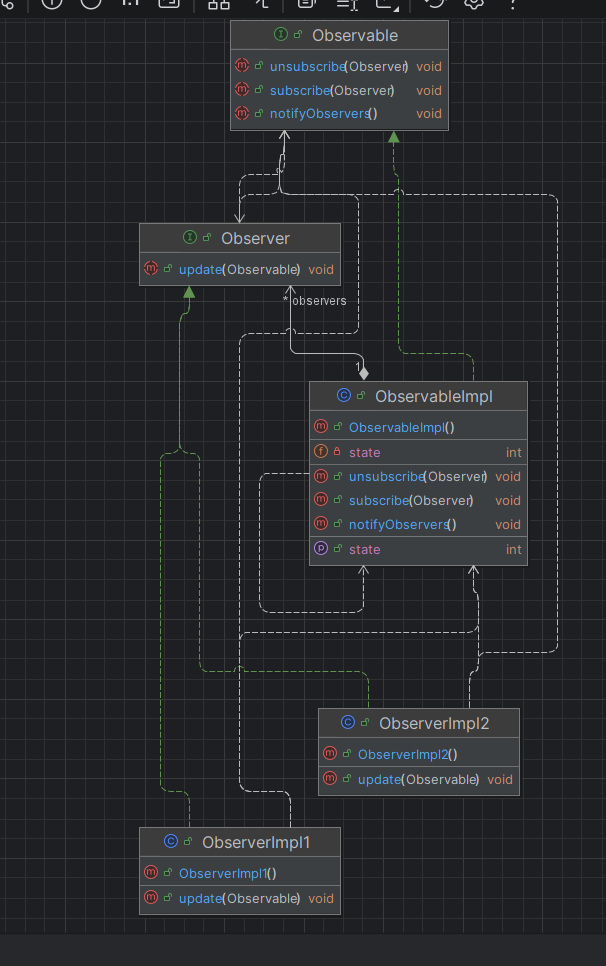

# Design Pattern Observer en Java

Ce projet est une implémentation simple et pédagogique du **Design Pattern Observer** (Observateur) en Java. Il s'inscrit dans le cadre de l'Activité Pratique N° 2 encadrée par M. Mohamed Youssfi. Il illustre le mécanisme de notification un-à-plusieurs entre un objet observable et ses observateurs.

## Architecture du Projet

Le projet suit une structure orientée objet propre avec les composants suivants :
- **`Observable`** (Interface) : Définit les méthodes de gestion des abonnements (`subscribe`, `unsubscribe`) et de notification (`notifyObservers`).
- **`Observer`** (Interface) : Définit la méthode de mise à jour (`update`).
- **`ObservableImpl`** : Implémentation concrète de l'observable qui maintient l'état et la liste des observateurs.
- **`ObserverImpl1` & `ObserverImpl2`** : Implémentations concrètes des observateurs réagissant aux changements d'état.
- **`Main`** : La classe principale (`EntryPoint`) permettant d'initialiser et de tester le comportement du pattern.

## Diagramme de Classes

Le diagramme ci-dessous illustre la structure des classes et des interfaces du projet :



## Technologies Utilisées
- **Java** (JDK 21)
- **Maven** (Gestion de projet et compilation)
- **IntelliJ IDEA** (Environnement de développement)

## Exemple d'utilisation

```java
ObservableImpl observable = new ObservableImpl();
Observer o1 = new ObserverImpl1();
Observer o2 = new ObserverImpl2();

observable.subscribe(o1);
observable.subscribe(o2);

// Modification de l'état et notification automatique des observateurs
observable.setState(3);
